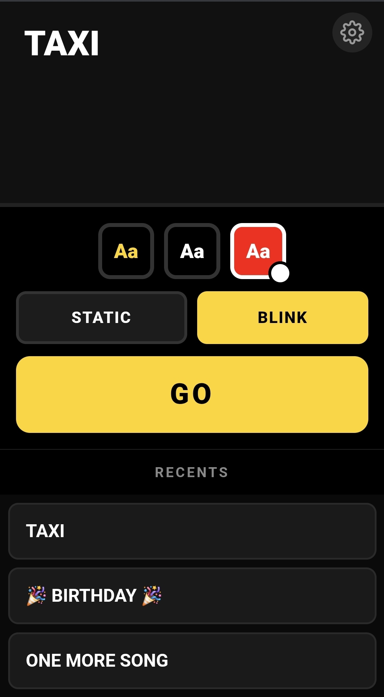
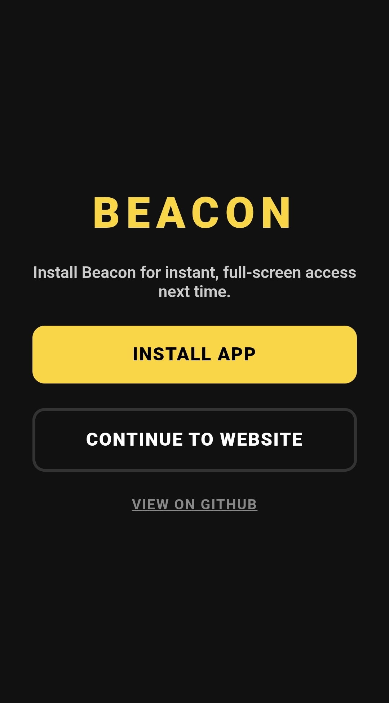

# 📡 beacon

**hold up your phone. get seen.**

### 👉 [cowglow.github.io/beacon](https://cowglow.github.io/beacon/) 👈

A tiny, loud, install-free web app that turns your phone into a giant glowing sign. Type a message, hit GO, hold it over your head. That's the whole app. No login screen, no onboarding carousel, no seventeen permission prompts before you're allowed to say `TAXI` in size 200 font.

<p align="center">
  
</p>

## see it move

<p align="center">
  <video src="docs/screencapture/ScreenRecording2026-Chrome.mp4" controls height="480">
    Your viewer can't preview video — the file's at <code>docs/screencapture/ScreenRecording2026-Chrome.mp4</code>.
  </video>
</p>

## get it (no app store, no download, no waiting)

This is a **PWA** — it lives at a URL, not in a walled garden. Open the link, tap **Install App**, done. It behaves exactly like a native app afterward: full-screen, home-screen icon, works with the wifi off.

<p align="center">
  
</p>

Changed your mind, or just browsing? Tap **Continue to Website** — it works exactly the same either way, forever, install or not. The cog icon on the compose screen brings this prompt back any time.

## why is this a website and not an App Store app?

Short answer: because you shouldn't have to trust us.

A native app is a sealed box. You tap install, a compiled binary lands on your phone, and you have basically no way to know what it's actually doing in there — what it's phoning home with, what it's reading off your device, what changes in a silent update six months from now. You're trusting the app store's review process and the vendor's word for it. That's the deal, whether you think about it or not.

A website doesn't get to hide like that. Right click → **View Source**. Open the Network tab. Read the whole thing — it's [right here](.), every line, no decompiler required. This app talks to zero servers, has zero accounts, and stores your messages in `localStorage` on *your* device, not ours. Not "we promise not to look" — there is nothing to look at, because there's no backend to send it to. That's not a policy, it's an architecture, and you can go verify it yourself in about ninety seconds.

This is basically the whole pitch of the **[IndieWeb](https://indieweb.org/)**: *"a people-focused alternative to the 'corporate web'"* — own your stuff, keep it simple, keep it inspectable. Their [principles](https://indieweb.org/principles) are worth a read if "install fewer black boxes" sounds like your kind of hill to die on. Same energy here, just pointed at a sign generator instead of a blog.

## what it actually does

- 🖊️ **Compose** — huge textarea, autofocus-free (nobody wants the keyboard ambushing them on page load), Shift+Enter for a real newline, plain Enter to GO
- 🎨 **Styles** — Black/Yellow, Black/White, or tap **Custom** for a native color picker on the background, with a one-tap black/white toggle for the text
- ✨ **Modes** — Static or Blink (a clean color-invert flash, not a seizure-bait flicker)
- 🕓 **Recents** — your last 10 signs, one tap to reload; long-press (mobile) or double-click (desktop) to delete, with a confirm dialog so you don't nuke `ONE MORE SONG` by accident
- 📶 **Offline-first** — service worker caches the app shell, so it still works with zero bars
- 🔒 **Wake lock + forced landscape** — the screen won't dim and the text stays huge and sideways-correct even if your browser can't lock orientation (CSS rotation fallback covers that)

## running it yourself

```bash
npm install
npm run dev      # dev server
npm run build    # type-check + production build
npm run preview  # serve the production build locally
```

Vanilla TypeScript, Vite, zero UI framework, zero runtime dependencies beyond what the Vite template ships with. See [`CLAUDE.md`](CLAUDE.md) if you're poking around the codebase and want the architecture notes.

Deploys to GitHub Pages on every push to `main` — see [`.github/workflows/deploy.yml`](.github/workflows/deploy.yml).

---

<p align="center"><sub>no accounts. no ads. no analytics. no idea what's tracking you, because nothing is. that's the whole point.</sub></p>
